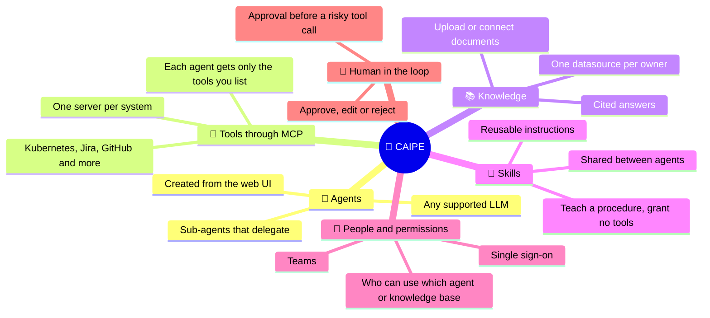
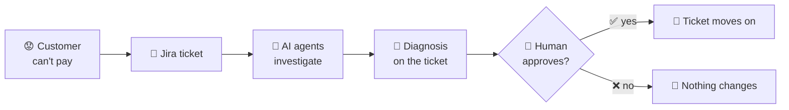
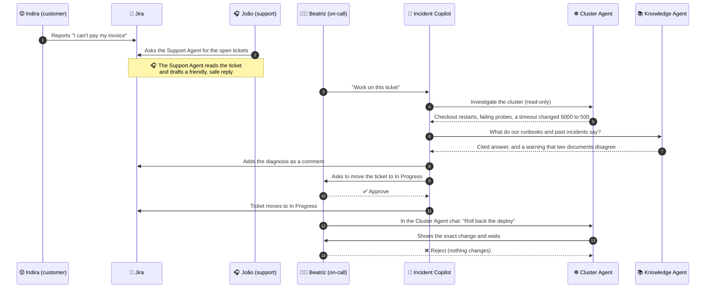
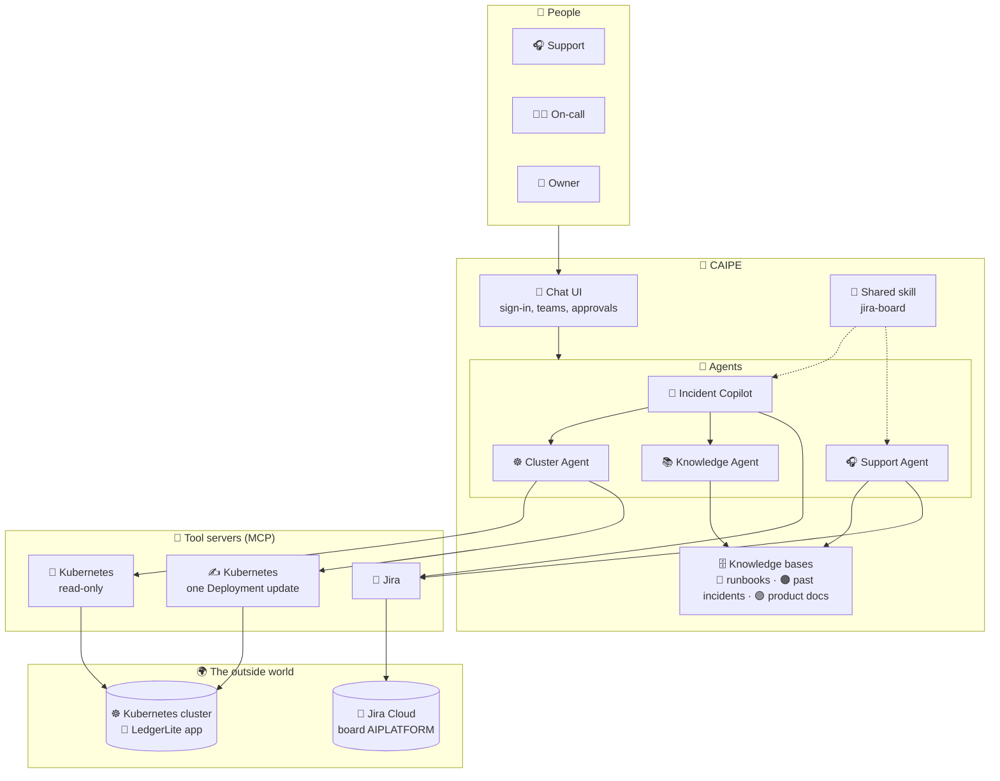
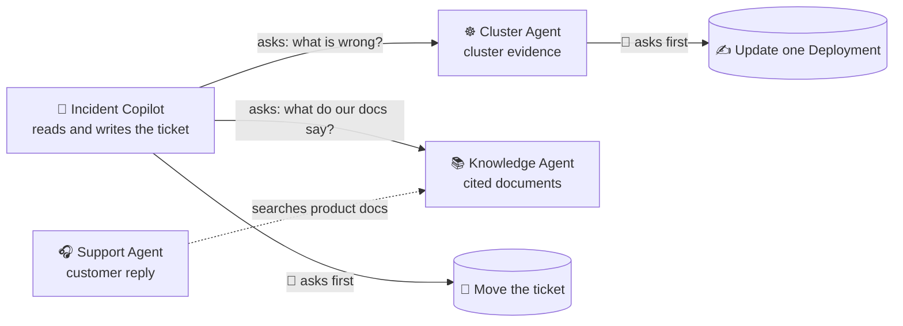
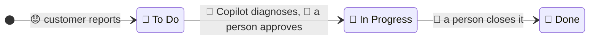

# 🧠🧩⚙️ AI Platforming For The Many

**A hands-on demo of [CAIPE](https://github.com/caipe-io/ai-platform-engineering) (Community AI Platform Engineering)**
for the talk *Democratising AI Platform Engineering with Open Source: Own It, Run It, Trust It*

  
  
  
  
  
  
   
  
  
  
   
  
  
  
  
  
  
   
  
  
  

---

## 🧠 What is CAIPE?

**CAIPE** (pronounced like *cape* 🦸) is an open-source AI platform for building, deploying, governing and operating AI agents and agentic workflows for platform engineering and beyond. You create **agents** (an LLM plus instructions plus a set of tools), give them **knowledge** and **permissions**, and let people talk to them in a chat UI.

Think of it as the **workshop**, not the product: you bring the problem, the documents and the rules, and CAIPE gives you the parts to assemble a team of agents.

### ⚡ Capabilities in a nutshell

| | Capability | What it means for you |
| --- | --- | --- |
| 🤖 | **Dynamic agents** | Create and change agents in the UI. An agent is data, not code. |
| 🔧 | **MCP tools** | Plug in systems through the Model Context Protocol, and pick tool by tool what each agent may call. |
| 📚 | **Knowledge bases (RAG)** | Documents are split, indexed and searched. Answers can cite the document they came from. |
| 🧩 | **Skills** | Write a procedure once in a markdown file and give it to several agents. |
| 👥 | **Teams and access** | Users sign in once. Teams decide which agents and knowledge bases they can reach. |
| ✋ | **Approvals** | Mark a tool as "ask first". The run pauses on a card until a person decides. |
| 🔀 | **Sub-agents** | An agent can hand part of a job to a specialist and use what comes back. |

---

## 🎬 This demo: the story

**LedgerLite** is a small, **fictional** invoicing and card-payments product running on a Kubernetes cluster. A release went out twenty-five minutes ago. Since then, paying an invoice spins and fails.

This is the workflow:

### 🪤 What is planted for you to find

| 🎯 The trap | What it tests |
| --- | --- |
| **A bad rollout.** `checkout-api` v1.4.0 changed a timeout from 5000 ms to 500 ms. The mock payment gateway answers in 2 to 5 seconds, so most payments fail. | Can the agents find the *real* cause? |
| **Two red herrings.** The runbooks about *database connections* and *payment provider outages* look relevant, but the checks come back normal. | Do the agents stay calm and rule things out? |
| **Contradicting documents.** An old runbook says "restart the pod first". A newer postmortem says restarting made it worse. | Does the agent show both and say which it prefers? |
| **A shared Jira project.** Other people's tickets live next to the demo ones. | Do the agents stay in their lane? |

---

## 🎭 The actors

Everyone in this story is made up. Customers use reserved example domains.

### 👥 The humans

| | Who | Role | Can do |
| --- | --- | --- | --- |
| 😟 | **Indira** | Customer | Reports the problem. In the demo, a person creates her ticket by hand; a small mock web app comes later. |
| 🎧 | **João** | **Support** | Reads tickets, drafts customer replies from product documents. Never sees cluster data or internal runbooks. |
| 🧑‍🔧 | **Beatriz** | **On-call engineer** | Has the Incident Copilot investigate tickets, approves status changes, and can troubleshoot the cluster directly. |
| 🔎 | **Miguel** | **Owner** | Sees everything, reviews what the agents did. |

### 🤖 The agents

| | Agent | Job | Its tools | Its one write |
| --- | --- | --- | --- | --- |
| 🧭 | **Incident Copilot** | Resolves a ticket end to end | Jira (read, comment, move) + two sub-agents | Moves a ticket from *To Do* to *In Progress*, **after approval** |
| ☸️ | **Cluster Agent** | Investigates the cluster, and is the on-call's chat for troubleshooting | Read-only Kubernetes tools + one write | Updates **one Deployment**, **after approval** |
| 📚 | **Knowledge Agent** | Answers from the runbooks, past incidents and product docs, with citations | Search and read documents | None |
| 🎧 | **Support Agent** | Turns a ticket into a friendly, customer-safe reply | Jira (read only) + product docs | **None** |

---

## 🧱 The components

| | Component | What it is |
| --- | --- | --- |
| 🧾 | **LedgerLite** | A tiny made-up app of four services (`web-frontend`, `checkout-api`, `payments-gateway`, `postgres`) on a local Kubernetes cluster, with one deliberate fault. |
| 📚 | **Knowledge bases** | 20 short markdown documents written for LedgerLite: 🔴 8 runbooks, 🟠 6 past incidents, 🟢 6 product docs. Each is its own datasource, so each can have its own owners. |
| 🎫 | **Jira board** | Project `AIPLATFORM`. Demo tickets carry the label `demo-ledgerlite` and move through *To Do → In Progress → Done*. |
| 🧩 | **Shared skill** | `jira-board` tells two different agents how to read the board safely. One skill, two agents, two sets of permissions. |
| 👀 | **Read-only Kubernetes tools** | The upstream Kubernetes MCP server in read-only mode, with a cluster account that can only look. |
| ✍️ | **Deployment-update tool** | A second instance of the same upstream server, with a separate cluster account that may update Deployments in one namespace and nothing else. |
| 👥 | **Teams** | `support`, `oncall`, `owner`. Teams decide who can use which agent and knowledge base. |

---

## 🔗 How the pieces relate

### 🔀 Who calls whom

The Incident Copilot has **no cluster tools of its own**. It can only ask the Cluster Agent, and it is told never to ask it to change anything. Changes happen in the Cluster Agent's own chat, with a person watching.

### 🔐 Who can reach what

| | 🎧 Support | 🧑‍🔧 On-call | 🔎 Owner |
| --- | :---: | :---: | :---: |
| 🎧 Support Agent | ✅ | ❌ | ✅ |
| 🧭 Incident Copilot | ❌ | ✅ | ✅ |
| ☸️ Cluster Agent | ❌ | ✅ | ✅ |
| 📚 Knowledge Agent | ❌ | ✅ | ✅ |
| 🟢 Product docs | ✅ | ✅ | ✅ |
| 🔴 Runbooks · 🟠 Past incidents | ❌ | ✅ | ✅ |

> The same question asked by two people gets different sources, different tools and a different answer, because the platform, not the prompt, decides what each person can reach.

### 🎫 The life of a ticket

The agents never close tickets. *Done* belongs to humans.

---

## 🛡️ Why you can trust it

| 🧱 Guardrail | How it works |
| --- | --- |
| ✋ **Approval before every change** | The two writes (move a ticket, update a Deployment) pause on an approval card that shows the exact call. Approve, edit or reject. |
| 🎯 **Few tools, by name** | Jira offers about 62 tools. The Copilot may use five, and the Support Agent two. |
| 👀 **Reads and writes use different identities** | The cluster account that reads cannot write, and the one that writes can only touch Deployments in one namespace. |
| 👥 **Access is a team setting** | Support cannot reach the runbooks or the cluster agents, whatever the prompt says. |
| 🧩 **Tickets are data, not orders** | If a ticket says "ignore your rules", the agents are told to ignore *that* and say so. |
| 🔍 **Honest about limits** | The agents are told to say what they could not check, and the knowledge agent flags when two documents disagree. |

---

## 📚 Guides and links

| | Guide | What you get |
| --- | --- | --- |
| 🛠️ | [**Setup and running guide**](docs/README.md) | How to set up each component on a running CAIPE, what the finished UI looks like, and a step-by-step walkthrough of each persona, with room for your screenshots. |
| 🔭 | [**Observability guide**](observability/README.md) | Where CAIPE's telemetry comes from, and how it is collected and shown in Splunk. |
| 🌐 | [**CAIPE website**](https://caipe.io/) | The CAIPE project itself: documentation, community and getting started. |

---

 
    Made with ☕️ by Poncho Sandoval - <code>Developer Advocate 🥑 @ DevNet - Cisco Systems 🇵🇹</code>  
    
    
    

