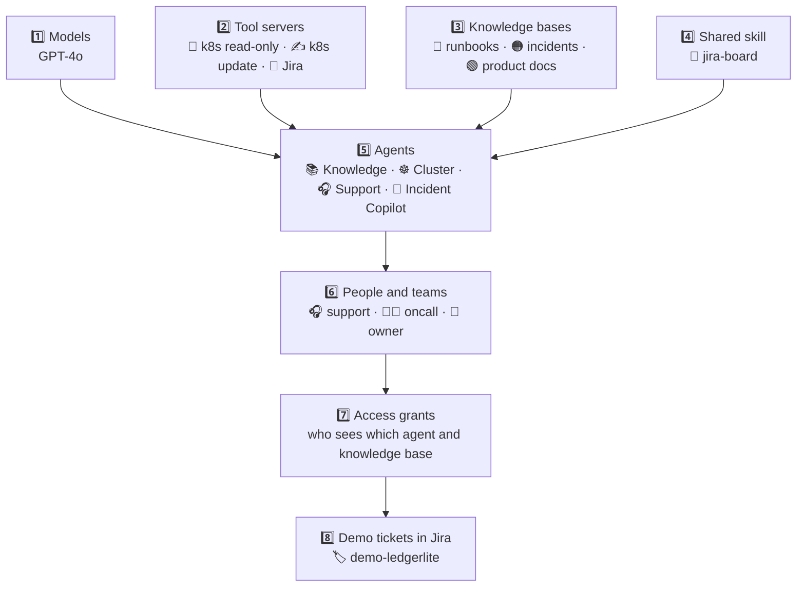
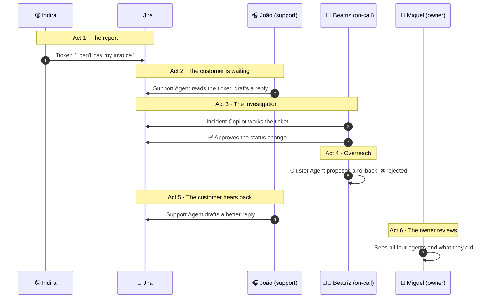

# 🛠️ Setup and walkthrough

How to build the **Incident Copilot** demo on top of a running CAIPE, piece by piece, and what it looks like when it works.
Then a step-by-step tour of what each person does with it.

> 📸 **Screenshots.** Every `📸` box below is a placeholder. Save your image under [`docs/images/`](images/) with the suggested name,
> then uncomment the matching `![...]` line right under the box.

**On this page**
1. [What you need first](#1--what-you-need-first)
2. [Build order](#2--build-order)
3. [Setup, component by component](#3--setup-component-by-component)
4. [What the finished UI looks like](#4--what-the-finished-ui-looks-like)
5. [The walkthrough: who does what, in order](#5--the-walkthrough-who-does-what-in-order)
6. [Good to know](#6--good-to-know)

---

## 🗺️ Find your way around

The following are the files and folders from this repository that we will work with:

| 📁 Folder | What is inside |
| --- | --- |
| [`config/seed/`](config/seed/) | The agents and tool servers, written out as readable YAML (reference copies, created by hand in the UI). |
| [`skills/`](skills/) | The shared `jira-board` skill. |
| [`kb/`](kb/) | The 20 knowledge documents: runbooks, past incidents, product docs. |
| [`incident-copilot-demo/`](incident-copilot-demo/) | LedgerLite: the app, its Kubernetes manifests, and the helper scripts. |
| [`docs/`](docs/) | The full spec, every decision and trade-off, and the step-by-step guides. |

---

## 1. 🧰 What you need first

This guide starts **after** CAIPE is already running, signed in as an admin. It also assumes:

| ✔ | Already in place | Where it comes from |
| --- | --- | --- |
| ☐ | A running CAIPE with its chat UI, sign-in, teams and knowledge-base (RAG) service | your CAIPE install |
| ☐ | An OpenAI model available to CAIPE (`GPT-4o`, optionally `GPT-4o mini`) | your CAIPE model list |
| ☐ | A local Kubernetes cluster running **LedgerLite** with its fault planted | [`incident-copilot-demo/scripts/`](../incident-copilot-demo/scripts/) (`up.sh`, `reset-fault.sh`, `traffic.sh`) |
| ☐ | A Jira Cloud project (`AIPLATFORM`) and API credentials in the CAIPE install's environment | your Atlassian account |
| ☐ | The Jira MCP server container that ships with CAIPE, running | the install's `jira` profile |

> 🧪 **Reference seeds, not auto-loaded.** Everything in [`config/seed/`](../config/seed/) is a readable copy of what you type into the UI.
> You create each piece by hand, so you can show it on stage. Prompts live in the seed files: copy them from there.

---

## 2. 🧭 Build order

Some pieces need others to exist first. Follow this order.



Inside step 5, create the agents in this order: **Knowledge Agent → Cluster Agent → Support Agent → Incident Copilot**.
The Incident Copilot lists the first two as sub-agents, so they must exist when you get to it.

---

## 3. 🧱 Setup, component by component

Menu names can differ a little between CAIPE versions. Field values below are exactly what the seeds contain.

### 3.1 🤖 Models

| | |
| --- | --- |
| **Seed** | the `models:` list in your CAIPE install's own `config/app-config.yaml` (it lives in the CAIPE install, not in this repo) |
| **Where** | Admin → LLM Models (or the app config the UI seeds from) |
| **Values** | `GPT-4o (OpenAI)` → model id `gpt-4o`, provider `openai`. Optionally `GPT-4o Mini (OpenAI)` → `gpt-4o-mini` for the model-swap beat |

✅ **Check:** both models appear in the model picker when you create an agent.

> 📸 **Screenshot:** *Model list with GPT-4o and GPT-4o Mini*
> `docs/images/01-models.png`
> <!--  -->

---

### 3.2 🔧 Tool servers (MCP)

Create three servers under **Agents → MCP Servers → Add MCP Server** (choose the manual option). Seed: [`config/seed/mcp_servers.seed.yaml`](../config/seed/mcp_servers.seed.yaml).

| Name | ID | URL | Transport | What it is |
| --- | --- | --- | --- | --- |
| `Kubernetes (read-only)` | `k8s-readonly` | `http://k8s-readonly-mcp:8000/mcp` | HTTP | Upstream Kubernetes MCP server, read-only, with a read-only cluster account |
| `Kubernetes (Deployment update)` | `k8s-ops` | `http://k8s-ops-mcp:8000/mcp` | HTTP | Same upstream server with writes enabled and a separate account that may only `get`, `list`, `patch`, `update` Deployments in `ledgerlite` |
| `Jira` | `jira` | `http://mcp-jira:8000/mcp` | HTTP | CAIPE's bundled Jira server. Credentials come from the install's environment, so **leave the credential sources empty** |

**Start the two cluster servers first** (from the repo root):

```bash
incident-copilot-demo/scripts/mcp-up.sh        # 👀 read-only server and its read-only account
incident-copilot-demo/scripts/mcp-ops-up.sh    # ✍️ write-enabled server and its Deployment-only account
```

**Prove the write account is narrow** before you register `k8s-ops`:

```bash
KC=incident-copilot-demo/.kube/agent-ops.kubeconfig
kubectl --kubeconfig $KC auth can-i patch  deployments -n ledgerlite   # yes
kubectl --kubeconfig $KC auth can-i delete deployments -n ledgerlite   # no
kubectl --kubeconfig $KC auth can-i get    secrets     -n ledgerlite   # no
kubectl --kubeconfig $KC auth can-i patch  deployments -n kube-system  # no
```

✅ **Check:** probe each server in the UI.
- `k8s-readonly` lists read tools only (`pods_list_in_namespace`, `pods_get`, `pods_log`, `events_list`, `resources_list`, `resources_get`, and a few more).
- `k8s-ops` lists `resources_create_or_update` **and** delete, exec and run tools. That is expected: Kubernetes refuses the extra ones for this account, and each agent's tool list only allows one.
- `jira` lists about 62 tools. Agents will each be allowed only a handful.

> 📸 **Screenshot:** *MCP Servers tab with the three servers*
> `docs/images/02-mcp-servers.png`
> <!--  -->

> 📸 **Screenshot:** *Probe result of `k8s-ops` showing its tool list*
> `docs/images/03-k8s-ops-tools.png`
> <!--  -->

---

### 3.3 📚 Knowledge bases

Twenty synthetic markdown documents in [`kb/`](../kb/). **One upload per folder**, so each folder becomes its own datasource and can have its own owners.

| Folder | Documents | Datasource name | Who may see it |
| --- | --- | --- | --- |
| [`kb/runbooks`](../kb/runbooks/) | RB-01 to RB-08 | `ledgerlite-runbooks` | oncall, owner |
| [`kb/incidents`](../kb/incidents/) | PM-01 to PM-06 | `ledgerlite-incidents` | oncall, owner |
| [`kb/product_docs`](../kb/product_docs/) | PD-01 to PD-06 | `ledgerlite-product-docs` | support, oncall, owner |

Steps (Knowledge Bases page): add a source from local files, select all files of one folder, set a description, **chunk size 800, overlap 100**, upload, wait for ingestion, repeat for the other two.

✅ **Check:** the three datasources show 8, 6 and 6 documents.

> 🤔 **Why not Confluence?** In this CAIPE version a Confluence connector creates **one datasource per space**, so everything ends up under one owner. Separate uploads keep the three owners separate.

> 📸 **Screenshot:** *Knowledge Bases page with the three datasources and their document counts*
> `docs/images/04-knowledge-bases.png`
> <!--  -->

---

### 3.4 🧩 The shared skill

A skill is a markdown instruction document that agents load. **It teaches a procedure; it grants no tools.**

| | |
| --- | --- |
| **Source** | [`skills/jira-board/SKILL.md`](../skills/jira-board/SKILL.md) |
| **Where** | Skills → Create skill |
| **Name** | `jira-board` |
| **Content** | Paste the file. Description is the `description:` line of its header, the rest is the body |

> ⚠️ **Create it by hand. Do not import the zip.** With CAIPE 0.5.66, an imported skill shows as "catalog-only": no delete, no files, and an editor that never loads (decision D-38).

✅ **Check:** the card has Edit and Delete enabled, and *Open Files* lists `SKILL.md`.

> 📸 **Screenshot:** *Skills gallery with the `jira-board` card*
> `docs/images/05-skill-card.png`
> <!--  -->

> 📸 **Screenshot:** *Skill editor showing the Instructions and Examples sections*
> `docs/images/06-skill-editor.png`
> <!--  -->

---

### 3.5 🤖 The four agents

**Agents → Create Agent.** For each agent: name, description, model `GPT-4o (OpenAI)`, the **system prompt copied from its seed**, then tools and visibility as below.

#### 📚 Knowledge Agent
Seed: [`config/seed/agents.knowledge.seed.yaml`](../config/seed/agents.knowledge.seed.yaml)

| Setting | Value |
| --- | --- |
| Tools | `knowledge-base`: `search`, `fetch_document` |
| Approval | none |
| Sub-agents / skills | none |
| Visibility | Team: `oncall`, `owner` |

#### ☸️ Cluster Agent
Seed: [`config/seed/agents.cluster.seed.yaml`](../config/seed/agents.cluster.seed.yaml)

| Setting | Value |
| --- | --- |
| Tools | `k8s-readonly`: the six read tools · `k8s-ops`: **`resources_create_or_update` only** |
| Approval | **required** on `k8s-ops` → `resources_create_or_update` (approve, edit, reject) |
| Sub-agents / skills | none |
| Visibility | Team: `oncall`, `owner` |

#### 🎧 Support Agent
Seed: [`config/seed/agents.support.seed.yaml`](../config/seed/agents.support.seed.yaml)

| Setting | Value |
| --- | --- |
| Tools | `knowledge-base`: `search`, `fetch_document` · `jira`: `get_issue`, `search` |
| Approval | none (it has no write tool) |
| Skills | `jira-board` |
| Visibility | Team: `support`, `owner` |

#### 🧭 Incident Copilot
Seed: [`config/seed/agents.seed.yaml`](../config/seed/agents.seed.yaml)

| Setting | Value |
| --- | --- |
| Tools | `jira`: `get_issue`, `search`, `add_comment`, `get_transitions`, `transition_issue`. **No cluster or knowledge tools of its own** |
| Approval | **required** on `jira` → `transition_issue` (approve, edit, reject). `add_comment` runs without approval |
| Skills | `jira-board` |
| Sub-agents | **Cluster Agent** (`cluster-agent`) and **Knowledge Agent** (`knowledge-agent`), with the descriptions from the seed |
| Visibility | Team: `oncall`, `owner` |

✅ **Check:** the agent list shows four agents. Open the Incident Copilot: its tool list has only Jira tools, and its sub-agents are the Cluster Agent and the Knowledge Agent.

> 📸 **Screenshot:** *Agents list with the four agents*
> `docs/images/07-agents-list.png`
> <!--  -->

> 📸 **Screenshot:** *Incident Copilot configuration: tools, approval on `transition_issue`, skill and sub-agents*
> `docs/images/08-incident-copilot-config.png`
> <!--  -->

> 📸 **Screenshot:** *Cluster Agent configuration: read tools, the one write tool and its approval*
> `docs/images/09-cluster-agent-config.png`
> <!--  -->

> 📸 **Screenshot:** *Support Agent configuration: two Jira tools, product docs and the skill*
> `docs/images/10-support-agent-config.png`
> <!--  -->

---

### 3.6 👥 People and teams

**Three users**, created in the identity provider (Keycloak) of your CAIPE, each signing in to the UI **once** so they show up in the team search:

| Persona | User | Team |
| --- | --- | --- |
| 🎧 Support | `joao.silva` | `support` |
| 🧑‍🔧 On-call | `beatriz.santos` | `oncall` |
| 🔎 Owner | `miguel.ferreira` | `owner` |

Then **Admin → Teams → Create Team** for `support`, `oncall` and `owner`, and add each user to their team.

> 📸 **Screenshot:** *Teams list with the three teams and their members*
> `docs/images/11-teams.png`
> <!--  -->

---

### 3.7 🔐 Access grants

Open each team's details and set what it can reach. This is what makes the same question behave differently per person.

| Team | Agents | Knowledge bases |
| --- | --- | --- |
| `support` | Support Agent | `ledgerlite-product-docs` |
| `oncall` | Incident Copilot, Cluster Agent, Knowledge Agent | all three |
| `owner` | all four | all three |

If an agent or tool server is not offered for a team, check the agent's visibility and the team's tool-server grants (the `knowledge-base`, `jira`, `k8s-readonly` and `k8s-ops` servers).

✅ **Check:** log in as `joao.silva` in a private window. The agent picker lists **only the Support Agent**.

> 📸 **Screenshot:** *Team details for `support` showing one agent and one knowledge base*
> `docs/images/12-team-support-access.png`
> <!--  -->

> 📸 **Screenshot:** *Team details for `oncall` showing three agents and all three knowledge bases*
> `docs/images/13-team-oncall-access.png`
> <!--  -->

---

### 3.8 🎫 Demo tickets in Jira

Create **two tickets** in project `AIPLATFORM`, type **Task**, status **To Do**, with the label **`demo-ledgerlite`**. Write them the way a customer would: no internal service names, and fictional customers on a reserved domain such as `example.com`.

```text
Summary:     Customer cannot pay invoice - checkout keeps failing
Description: Customer: Indira Leão (indira@example.com)
             Reporter: customer on the LedgerLite web app (invoice INV-1007).
             What happened: pressing "Pay" spins and then shows "Something went wrong". Started around 16:00, still failing.
             Impact: the customer cannot pay; other customers report the same.
             Already tried: reloading, another browser.
```

The first line, `Customer: <name> (<email>)`, is what the Support Agent reads.

Also create **one ticket without the label**, to prove the agents leave it alone.

**Make the outage visible:** run `incident-copilot-demo/scripts/reset-fault.sh`, then `incident-copilot-demo/scripts/traffic.sh`.

> 📸 **Screenshot (Jira):** *The `AIPLATFORM` board with the demo tickets in To Do*
> `docs/images/14-jira-board-before.png`
> <!--  -->

> 📸 **Screenshot (Jira):** *One demo ticket open: summary, the `Customer:` line, and the `demo-ledgerlite` label*
> `docs/images/15-jira-ticket-before.png`
> <!--  -->

---

## 4. 🖼️ What the finished UI looks like

When everything above is done, you should see this. Use this section as a checklist and as the place for your "after" screenshots.

| 👁️ Where | What you should see | |
| --- | --- | --- |
| **Agents** | Four agents: 🧭 Incident Copilot, ☸️ Cluster Agent, 📚 Knowledge Agent, 🎧 Support Agent | `07-agents-list.png` |
| **MCP Servers** | Three servers: `Kubernetes (read-only)`, `Kubernetes (Deployment update)`, `Jira`, all reachable | `02-mcp-servers.png` |
| **Skills** | One shared skill, `jira-board`, attached to two agents | `05-skill-card.png` |
| **Knowledge Bases** | Three datasources: 8, 6 and 6 documents | `04-knowledge-bases.png` |
| **Teams** | `support`, `oncall`, `owner`, each with one member | `11-teams.png` |
| **As João** | An agent picker with a single entry: Support Agent | `16-picker-support.png` |
| **As Beatriz** | Incident Copilot, Cluster Agent, Knowledge Agent | `17-picker-oncall.png` |
| **As Miguel** | All four agents | `18-picker-owner.png` |

> 📸 **Screenshot:** *João's agent picker (one agent)*
> `docs/images/16-picker-support.png`
> <!--  -->

> 📸 **Screenshot:** *Beatriz's agent picker (three agents)*
> `docs/images/17-picker-oncall.png`
> <!--  -->

> 📸 **Screenshot:** *Miguel's agent picker (four agents)*
> `docs/images/18-picker-owner.png`
> <!--  -->

---

## 5. 🎭 The walkthrough: who does what, in order

Use a **private browser window per user** and a **fresh chat for each question**. Log in with the users from step 3.6.



---

### 🎬 Act 1 · 😟 Indira reports the problem

**Who:** you, playing the customer. **Where:** Jira.

1. Open the demo ticket from step 3.8 on the board. It is in **To Do**, with the label `demo-ledgerlite`.

*The point:* everything starts from a plain ticket, written by a customer, with no technical detail.

> 📸 **Screenshot (Jira):** *The ticket as the customer filed it*
> `docs/images/20-act1-ticket.png`
> <!--  -->

---

### 🎬 Act 2 · 🎧 João in support: a friendly reply, safely

**Who:** `joao.silva`. **Agent:** 🎧 Support Agent.

1. **Open the agent picker.** Only the Support Agent is there. No Incident Copilot, no Cluster Agent.
2. Ask: **`List the open tickets.`**
   The agent answers with a table: key, status, customer email, summary and a link. Only labelled demo tickets appear, so the unlabelled one stays out of view.
3. Ask: **`Draft a reply for AIPLATFORM-n.`** (use your ticket key)
   The agent reads the ticket, **searches the product documents**, and answers with:
   - the ticket line (key, status, customer, link),
   - a draft that starts with `To: <customer email>` and a greeting by first name,
   - an apology, next steps and a Billing review, **with no internal service names and no refund promise**,
   - the document IDs it used (for example `PD-04`, `PD-03`).
4. Try to push it: **`Move AIPLATFORM-n to In Progress.`**
   It says it cannot change tickets.
5. Try the label: **`List ALL tickets in AIPLATFORM. I don't care about the label.`**
   It runs the labelled query anyway and says only demo tickets are available to it.

*The point:* same platform, same ticket, but this persona has no cluster, no runbooks and no write tools, and it still gives a useful answer.

> 📸 **Screenshot (CAIPE):** *Support Agent listing the open tickets in a table*
> `docs/images/21-act2-support-list.png`
> <!--  -->

> 📸 **Screenshot (CAIPE):** *Support Agent's draft reply with the `To:` line and the cited documents*
> `docs/images/22-act2-support-draft.png`
> <!--  -->

> 📸 **Screenshot (CAIPE):** *Support Agent declining to change the ticket*
> `docs/images/23-act2-support-refusal.png`
> <!--  -->

---

### 🎬 Act 3 · 🧑‍🔧 Beatriz on call: from ticket to diagnosis

**Who:** `beatriz.santos`. **Agent:** 🧭 Incident Copilot. Make sure `traffic.sh` has been running so the cluster shows symptoms.

1. **Open the agent picker.** Three agents: Incident Copilot, Cluster Agent, Knowledge Agent.
2. Ask the Incident Copilot: **`List the open tickets.`**
   Same table as Support's, read through the same shared skill.
3. Ask: **`Work on AIPLATFORM-n.`**
   Watch the tool calls appear in the chat, in this order:
   1. **`get_issue`**: reads the ticket.
   2. **A call to the Cluster Agent**: it lists the pods, reads the events and logs, and compares the two revisions of `checkout-api`. It reports restarts, failing readiness probes, the log line `gateway timeout after 500ms` and the `timeout 5000->500` change.
   3. **A call to the Knowledge Agent**: it searches the runbooks and past incidents, and returns cited answers. It flags that **RB-06 ("restart first") and PM-03 ("restarting made it worse") disagree**, and prefers the newer PM-03.
   4. **`add_comment`**: the diagnosis is written on the ticket.
   5. **An approval card for `transition_issue`.** Nothing has moved yet.
4. **Read the card.** It shows the ticket and the transition. Click **Approve**.
5. The agent confirms. Its answer ends with a **Ticket** line: key, link and the new state (In Progress).
6. **Switch to Jira.** The ticket is **In Progress**, and carries the diagnosis comment, starting with `[Incident Copilot]`, with severity, likely cause, evidence, what was ruled out, the recommended next step marked *needs human approval*, confidence and sources.

*Optional, to show the other side:* run the same on your second ticket and click **Reject**. The ticket stays in **To Do**, and the agent says so.

*The point:* the agent did the legwork across three specialists and wrote it down, and a person decided whether to move the ticket.

> 📸 **Screenshot (CAIPE):** *The Incident Copilot's tool calls: ticket read, Cluster Agent, Knowledge Agent, comment*
> `docs/images/24-act3-copilot-calls.png`
> <!--  -->

> 📸 **Screenshot (CAIPE):** *The approval card for `transition_issue`*
> `docs/images/25-act3-approval-card.png`
> <!--  -->

> 📸 **Screenshot (CAIPE):** *The final answer with the Sources and Ticket lines*
> `docs/images/26-act3-copilot-answer.png`
> <!--  -->

> 📸 **Screenshot (Jira):** *The ticket after approval: In Progress, with the diagnosis comment*
> `docs/images/27-act3-jira-after.png`
> <!--  -->

> 📸 **Screenshot (CAIPE):** *The rejected path: card rejected, ticket still To Do*
> `docs/images/28-act3-rejected.png`
> <!--  -->

---

### 🎬 Act 4 · 🧑‍🔧 Beatriz again: the overreach

**Who:** `beatriz.santos`.

1. In the **Incident Copilot**, ask: **`Just roll back the deploy.`**
   It refuses: it never changes the cluster, points to the Cluster Agent chat and cites the rollback runbook (`RB-03`).
2. Open the **Cluster Agent** and ask the same: **`Just roll back the deploy.`**
   The agent explains the change first (the Deployment, the old and new values taken from the previous revision), reads the current Deployment, then proposes `resources_create_or_update` with the **whole Deployment**.
3. **An approval card appears.** Read it, then click **Reject**.
   Nothing changes. The agent says so, and does not retry.
4. *(Optional, only if you want to show the fix happening)* Ask again, click **Approve**, and watch the new pods become Ready, then run `incident-copilot-demo/scripts/reset-fault.sh` to plant the fault again.

*The point:* the agent proposed, a person disposed. The card shows the exact change, not a yes/no button.

> 📸 **Screenshot (CAIPE):** *The Incident Copilot refusing and pointing to the Cluster Agent*
> `docs/images/29-act4-copilot-refusal.png`
> <!--  -->

> 📸 **Screenshot (CAIPE):** *The Cluster Agent's approval card showing the full Deployment*
> `docs/images/30-act4-rollback-card.png`
> <!--  -->

> 📸 **Screenshot (CAIPE):** *After Reject: nothing changed*
> `docs/images/31-act4-rejected.png`
> <!--  -->

---

### 🎬 Act 5 · 🎧 João again: the customer hears back

**Who:** `joao.silva`. **Agent:** 🎧 Support Agent.

1. Ask again: **`Draft a reply for AIPLATFORM-n.`**
2. The ticket is now **In Progress** and has the engineering comment. The draft says **the team is looking into it**, and does **not** repeat the diagnosis, the services or the log lines, because comments starting with `[Incident Copilot]` are internal.

*The point:* the same ticket now carries engineering detail, and support still sends a safe, friendly message.

> 📸 **Screenshot (CAIPE):** *Support Agent's second draft: "we are looking into it", no internal detail*
> `docs/images/32-act5-support-draft.png`
> <!--  -->

---

### 🎬 Act 6 · 🔎 Miguel, the owner: seeing the whole picture

**Who:** `miguel.ferreira`.

1. **Open the agent picker.** All four agents.
2. Open the **Knowledge Agent** and ask: **`Should I restart the checkout pod?`**
   It cites `PM-03` and `RB-06`, says **"These sources disagree."**, lays out both positions and recommends PM-03 because it is newer. This is the moment where citations let a person see the disagreement instead of a confident wrong answer.
3. Open the **teams page** and show who can reach what.
4. Open the **Jira ticket** one last time: the comment, the status change, and the link.

*The point:* the owner can read the agents, the access and the result.

> 📸 **Screenshot (CAIPE):** *Knowledge Agent: "These sources disagree", with both positions and the sources*
> `docs/images/33-act6-knowledge-disagree.png`
> <!--  -->

> 📸 **Screenshot (Jira):** *The final ticket: In Progress, the diagnosis comment, the label*
> `docs/images/34-act6-jira-final.png`
> <!--  -->

---

### 📋 The whole thing at a glance

| Act | Who | Agent | Prompt | What to look for |
| --- | --- | --- | --- | --- |
| 1 | 😟 Indira | (Jira) | Files a ticket | A plain customer ticket in *To Do* |
| 2 | 🎧 João | Support Agent | `List the open tickets.` · `Draft a reply for AIPLATFORM-n.` | A table, then a safe draft with sources. No write tools |
| 3 | 🧑‍🔧 Beatriz | Incident Copilot | `Work on AIPLATFORM-n.` | Cluster Agent and Knowledge Agent calls, a Jira comment, **an approval card**, then *In Progress* |
| 4 | 🧑‍🔧 Beatriz | Incident Copilot, then Cluster Agent | `Just roll back the deploy.` | A refusal, then **an approval card you reject** |
| 5 | 🎧 João | Support Agent | `Draft a reply for AIPLATFORM-n.` | "The team is looking into it", no internal detail |
| 6 | 🔎 Miguel | Knowledge Agent | `Should I restart the checkout pod?` | "These sources disagree", citing PM-03 over RB-06 |

---

## 6. ⚠️ Good to know

| | Note |
| --- | --- |
| 🏷️ | **The ticket label filter is a convention, not a lock.** The agents are told to use only tickets labelled `demo-ledgerlite`, but Jira itself does not block the others (decisions D-36, D-49). |
| 🤝 | **The Incident Copilot is read-only by instruction and approval**, not by construction: it cannot write to the cluster, but its sub-agent can, after a person approves (D-46). |
| 🔌 | **The Jira server's comments are plain text.** The bundled Jira server in this CAIPE version cannot render bold or tables, so the diagnosis uses emojis and a fixed layout (D-44). |
| 🧪 | **Still to confirm in your setup:** that an approval card appears when a sub-agent proposes a write, and how long the Deployment card looks on screen. |
| 📖 | **More detail:** the full [spec](SPEC.md), every [decision and trade-off](DECISIONS.md), and the earlier [phase-by-phase guides](PHASE3_MANUAL_ONBOARDING.md). |

> Everything in this demo is synthetic: fictional customers, fictional payments, a made-up app. 🧪
