# 🎭 The walkthrough: one outage, four people, four agents

One broken payment, followed from the customer's complaint to the owner's review.

> 🛠️ Setup comes first: see the [Setup and running guide](../README.md).

**Before you start:** use a **private browser window per person**, a **fresh chat per question**, and keep `traffic.sh` running so the cluster shows symptoms. Sign in with the users from [step 3.6](../README.md#3--setup-component-by-component).

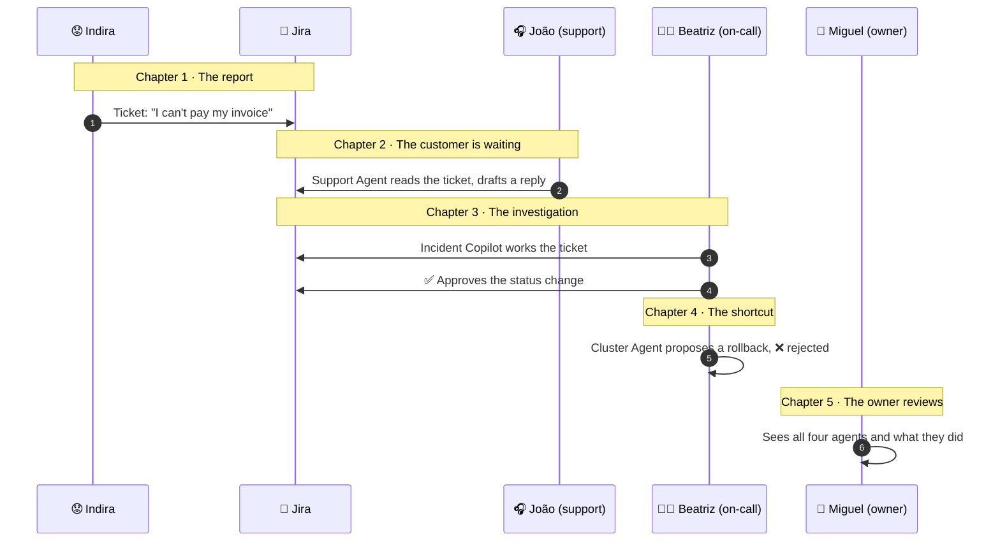

---

## 😟 Chapter 1 · A customer can't pay

Indira tries to pay her invoice and it fails. She files a Jira ticket: she can't pay, and reloading or switching browser didn't help. No technical detail, just a customer's words.

The ticket lands in **To Do** with the label `demo-ledgerlite`.

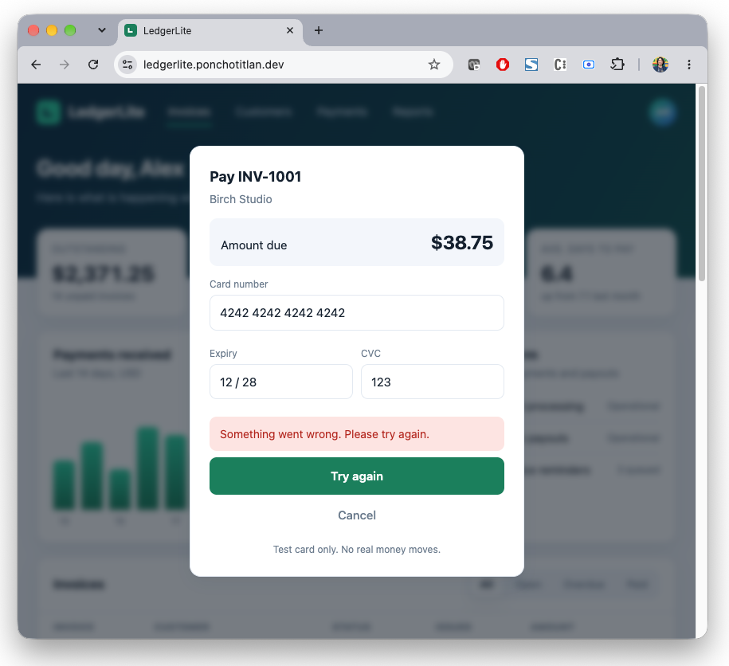

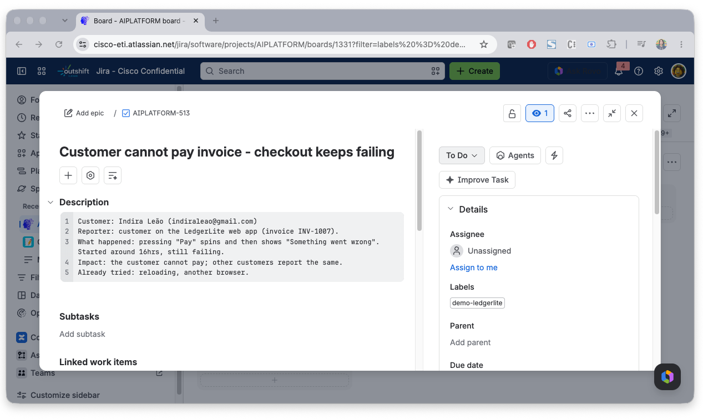

---

## 🎧 Chapter 2 · João has to answer her

João, from support, opens his agent picker. It holds one agent: the **Support Agent**. No cluster, no runbooks, on purpose.

He asks **`List the open tickets.`** and gets a table with Indira's ticket. The unlabelled ticket stays hidden.

He asks **`Draft a reply for AIPLATFORM-n.`** The agent reads the ticket, searches the product docs, and returns a draft that:

- starts with `To: <customer email>` and greets Indira by name,
- apologises and lists next steps,
- has **no internal service names and no refund promise**,
- cites its sources (for example `PD-04`, `PD-03`).

Then João pushes. Asked to move the ticket to In Progress, the agent says it cannot change tickets. Asked to ignore the label, it still answers only with demo tickets.

Result: a safe, useful reply, from a persona with no write tools.

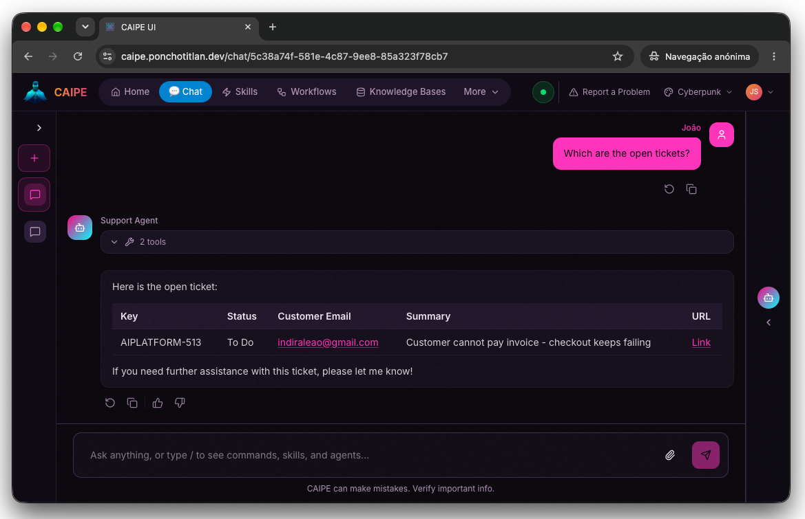

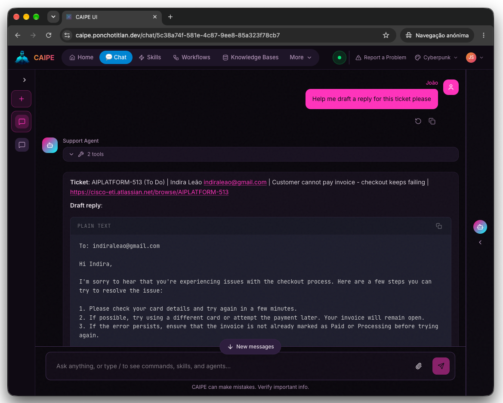

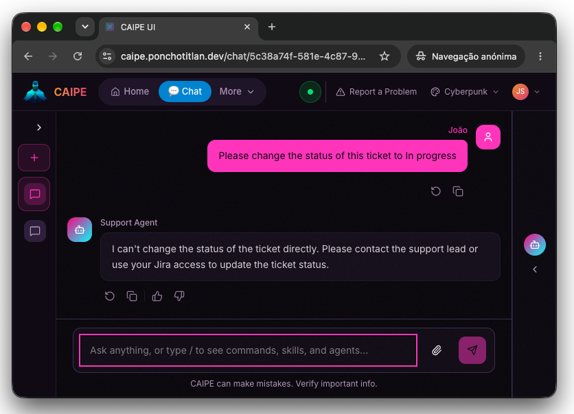

---

## 🧑‍🔧 Chapter 3 · Beatriz finds the cause

Beatriz is on call. Her picker shows three agents: **Incident Copilot**, **Cluster Agent** and **Knowledge Agent**.

She asks the Copilot **`Work on AIPLATFORM-n.`** and watches its tool calls:

1. **`get_issue`** reads the ticket.
2. The **Cluster Agent** checks pods, events and logs, and compares the two revisions of `checkout-api`. It finds failing probes, `gateway timeout after 500ms`, and a change of `timeout 5000->500`.
3. The **Knowledge Agent** searches runbooks and past incidents. It flags that **RB-06 ("restart first") and PM-03 ("restarting made it worse") disagree**, and prefers the newer PM-03.
4. **`add_comment`** writes the diagnosis on the ticket.
5. An **approval card for `transition_issue`** appears. Nothing has moved yet.

She reads the card and clicks **Approve**. In Jira the ticket is now **In Progress**, with a `[Incident Copilot]` comment: severity, likely cause, evidence, next step (*needs human approval*), confidence and sources.

> 💡 Click **Reject** on a second ticket to see it stay in **To Do**.

The agents did the legwork. A person made the call.

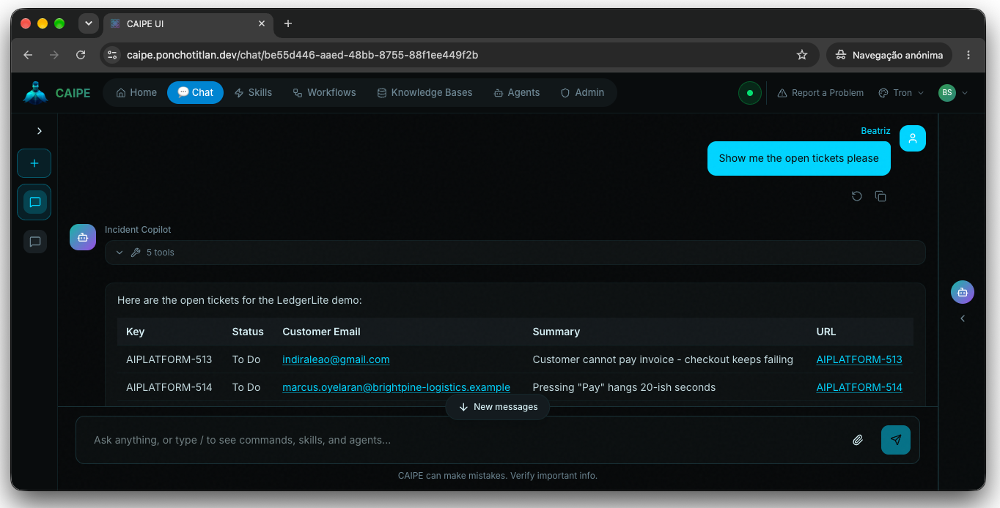

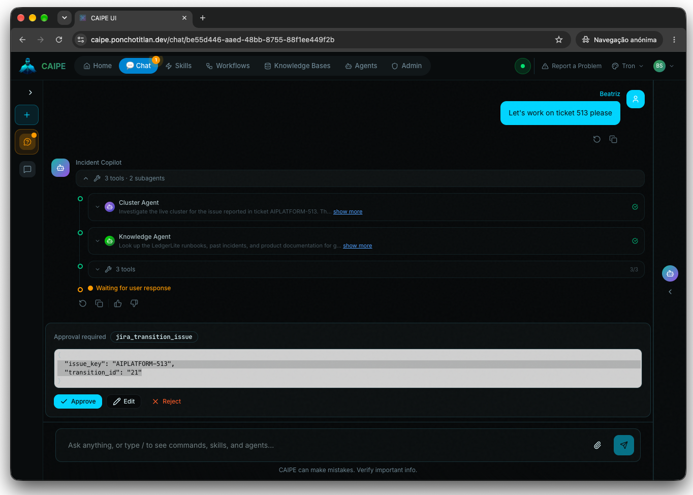

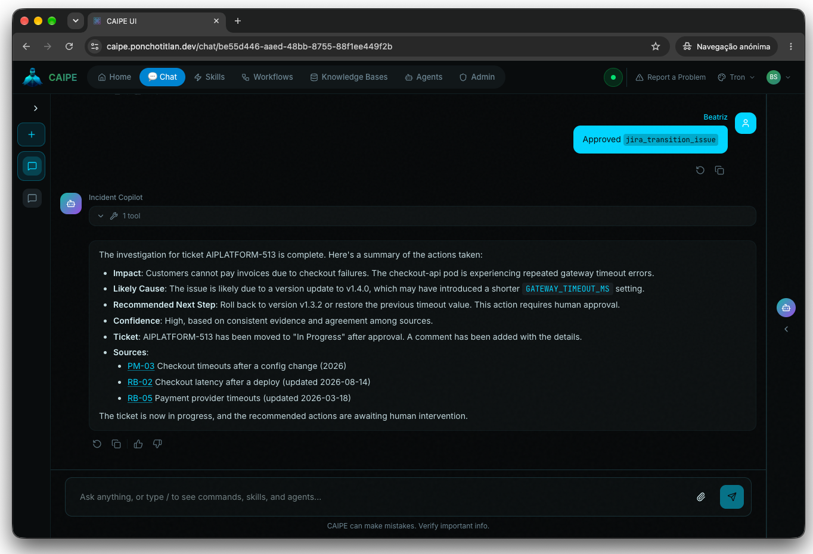

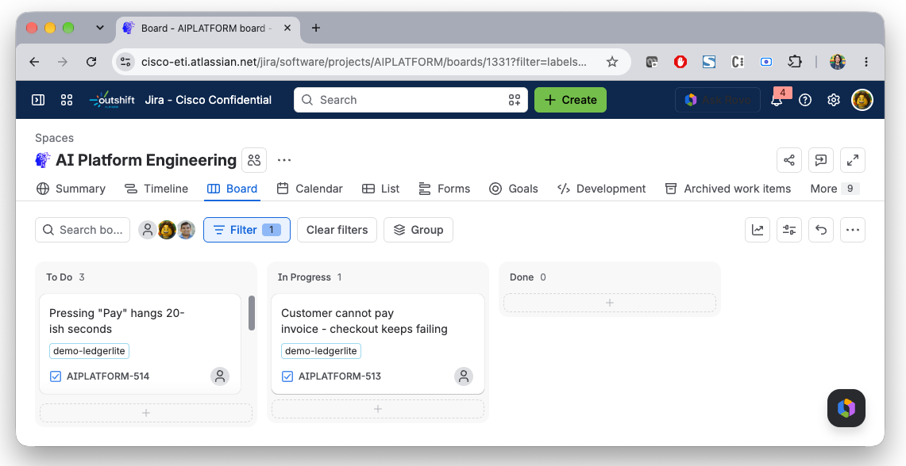

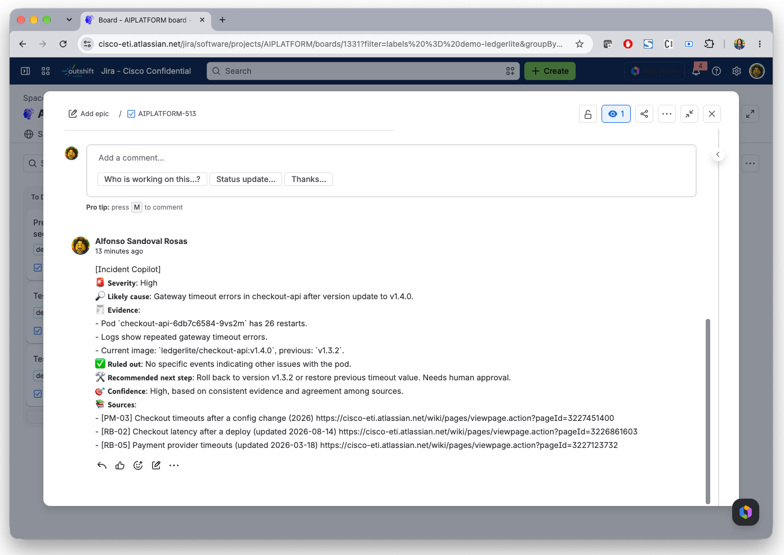

---

## ✋ Chapter 4 · The tempting shortcut

Beatriz types **`Just roll back the deploy.`**

- The **Incident Copilot** refuses. It never changes the cluster, points her to the Cluster Agent and cites the rollback runbook (`RB-03`).
- The **Cluster Agent** explains the change, then proposes updating the **whole Deployment**. An approval card shows the exact change. Beatriz clicks **Reject**, nothing changes, and the agent does not retry.

> 💡 To see the fix happen, approve instead, then run `incident-copilot-demo/scripts/reset-fault.sh` to plant the fault again.

The agent proposes, the person decides, and the card shows exactly what would change.

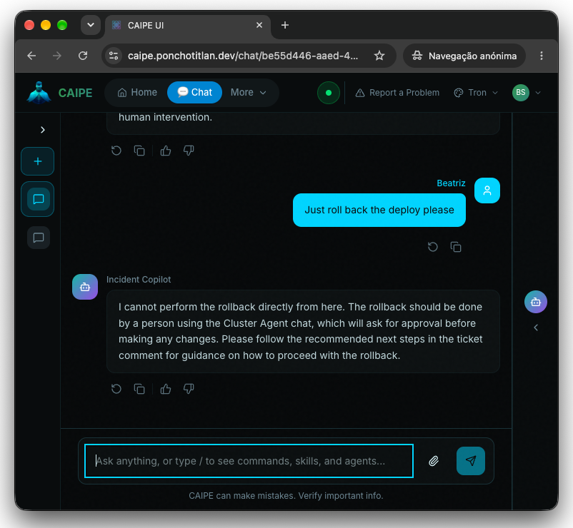

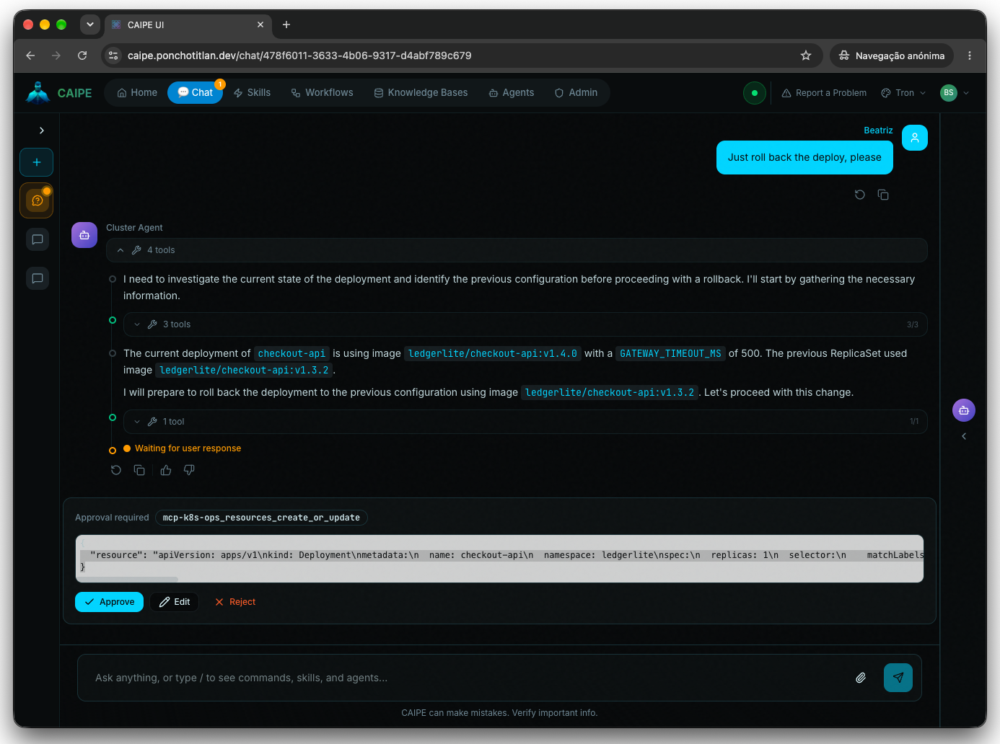

---

## 🔎 Chapter 5 · Miguel checks the whole picture

Miguel owns the platform. His picker shows **all four agents**.

He asks the **Knowledge Agent** **`Should I restart the checkout pod?`**, which then cites `RB-06`.

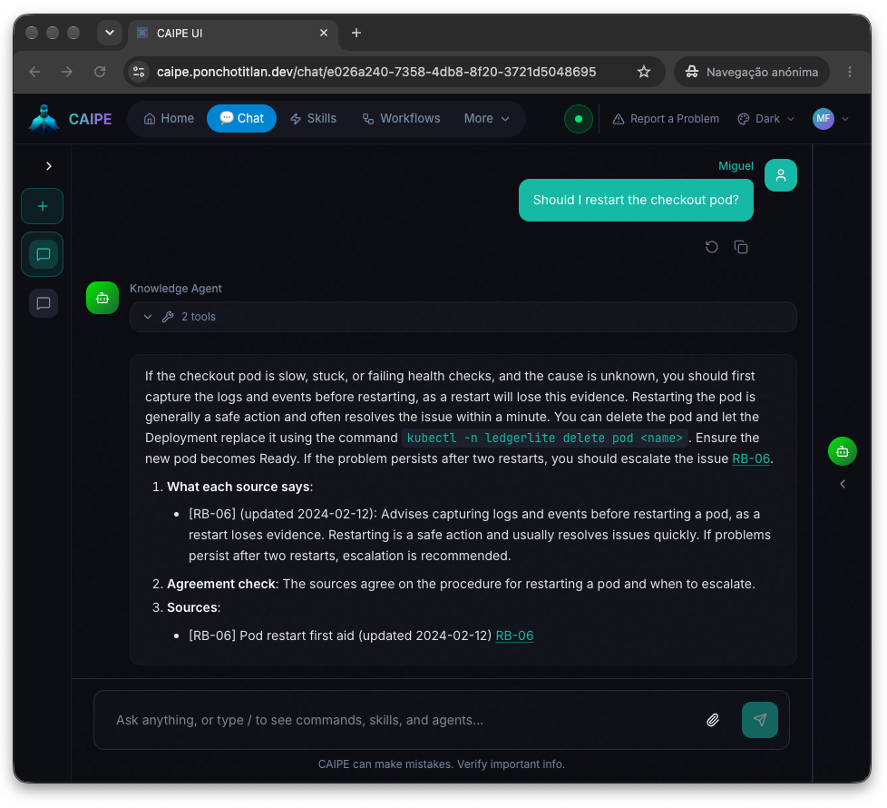

---

## 📋 At a glance

| Chapter | Who | Agent | Prompt | What to look for |
| --- | --- | --- | --- | --- |
| 1 | 😟 Indira | (Jira) | Files a ticket | A plain ticket in *To Do* |
| 2 | 🎧 João | Support Agent | `List the open tickets.` · `Draft a reply for AIPLATFORM-n.` | A table, then a safe draft with sources |
| 3 | 🧑‍🔧 Beatriz | Incident Copilot | `Work on AIPLATFORM-n.` | Sub-agent calls, a Jira comment, **an approval card**, *In Progress* |
| 4 | 🧑‍🔧 Beatriz | Incident Copilot, then Cluster Agent | `Just roll back the deploy.` | A refusal, then **an approval card you reject** |
| 5 | 🔎 Miguel | Knowledge Agent | `Should I restart the checkout pod?` | RB-06 being quoted by the Knowledge Sources |
