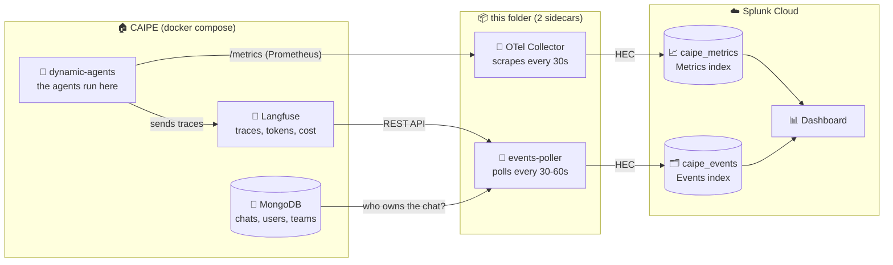
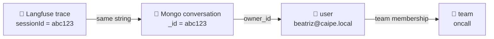

# CAIPE observability: a field guide

*Where do the numbers come from, who carries them, and why does one chart only wake up when somebody actually uses the product?*

CAIPE runs several agents that talk to an LLM, call tools and sometimes wait for a human to click "approve". This folder answers the admin's questions about all of that in one Splunk Cloud dashboard: who is using it, what it costs, how fast it is, and which tools misbehave.

No CAIPE code was changed to get here. CAIPE already leaves a trail of telemetry. We built the thing that picks it up and walks it to Splunk.

> **Privacy first.** Only metadata leaves the host: counts, tokens, cost, latency, agent, model, user and team. No prompts, no answers, no tool arguments.

---

## 1. The whole thing on one page



Two pipes, because there are two kinds of data:

| | Pipe 1: **metrics** | Pipe 2: **events** |
|---|---|---|
| Question it answers | "How is it behaving *right now*?" | "Who did what, and what did it cost?" |
| Shape | Counters and histograms, sampled on a timer | One record per request / per LLM call |
| Carrier | OpenTelemetry Collector | `poller.py` (a small Python loop) |
| Splunk index | `caipe_metrics` (Metrics type) | `caipe_events` (Events type) |

---

## 2. The cast: what CAIPE exports on its own

Not everything in CAIPE's stack is useful here. This is what we found by poking around, and what we use.

| Component | What it offers | Used? |
|---|---|---|
| 🤖 **dynamic-agents** | A Prometheus `/metrics` endpoint (`da_*` series): turns, LLM calls, tool calls, latencies, active streams. Also sends a trace for every agent run to Langfuse. | ✅ **Yes**, both |
| 🔭 **Langfuse** (web, worker, ClickHouse, Postgres, Redis, MinIO) | Stores every trace and every LLM call with **token counts, cost and latency**. Has a REST API. | ✅ **Yes** |
| 🍃 **MongoDB** | `conversations` (who owns each chat), `users`, `team_membership_sources` (who is in which team). | ✅ **Yes**, for "who" |
| 🧾 audit-service | An event store. Today it only holds internal `cas_reconcile` heartbeats, no RBAC decisions. | ❌ No |
| 🚪 agentgateway / 🔐 OpenFGA | Proxy and authorization. Great, but not part of this dashboard. | ❌ No |

The trick that makes per-user numbers possible: **Langfuse's `sessionId` is the same string as the MongoDB conversation `_id`**. Follow the chain:



Prometheus has no idea who anyone is; Langfuse alone doesn't either (its `userId` is empty). This join is the whole point of the poller.

### The `da_*` metrics we keep

| Metric | Labels | Used for |
|---|---|---|
| `da_turns_total` | agent, model, status, turn_type | Turns by outcome |
| `da_turn_time_to_first_response_seconds` | agent, model | "How long until the user sees something" |
| `da_llm_calls_total`, `da_llm_call_duration_seconds` | agent, model, status | LLM call latency by model |
| `da_tool_calls_total`, `da_tool_call_duration_seconds` | tool, agent, status | Tool health |
| `da_active_streams`, `da_active_requests` | none | Live load |

---

## 3. What we put in the middle

Two small containers (`docker-compose.yaml`), both joining the CAIPE network so they can reach the others by name. Nothing in the CAIPE stack is touched.

### 3a. OpenTelemetry Collector (`otel-collector.yaml`)

Does exactly three things:

1. **Scrapes** `dynamic-agents:8001/metrics` every 30 seconds.
2. **Filters** to the `da_*` series we use. Python and process noise stays home.
3. **Ships** to Splunk through the `splunk_hec` exporter into `caipe_metrics`, tagging each point with `service.name=caipe` and `deployment.environment`.

### 3b. Events poller (`poller.py`)

A loop that wakes every `POLL_INTERVAL` seconds:

1. Asks **Langfuse** for traces and LLM generations since the last cycle.
2. Looks up each trace's conversation in **MongoDB** to find the owner and their teams.
3. Sends one JSON event per trace and per LLM call to Splunk.
4. Remembers where it stopped (a small state volume) and skips ids it already sent, so restarts don't duplicate anything.

First run backfills `BACKFILL_DAYS` (default 30). Once a day it also sends one `caipe:inventory` event listing configured agents, team slugs and counts.

| Sourcetype | One event per | Fields |
|---|---|---|
| `caipe:trace` | agent request | `trace_id`, `session_id`, `agent`, `latency_s`, `cost_usd`, `user`, `teams`, `client_type` |
| `caipe:llm_call` | LLM call | `generation_id`, `trace_id`, `session_id`, `agent`, `model`, `input_tokens`, `output_tokens`, `total_tokens`, `cost_usd`, `latency_s`, `user`, `teams`, `client_type` |
| `caipe:inventory` | day | `agents`, `teams`, `users`, `mcp_servers` |

Spend comes from Langfuse's own price table. **Tokens and spend come from here and not from Prometheus** (see the gotchas).

---

## 4. How it gets to Splunk Cloud

Both pipes use the **HTTP Event Collector (HEC)**: HTTPS POSTs with an `Authorization: Splunk <token>` header.

- The collector sends to `/services/collector` in **metrics format** (Splunk stores each label as a *dimension*, e.g. `agent_name`, `model_id`, `tool_name`).
- The poller sends to `/services/collector/event`.
- If Splunk is down, the collector retries and the poller simply tries again next cycle.

---

## 5. Setting up Splunk Cloud by hand

You need admin rights on the stack. Five minutes.

### Step 1. Create two indexes (Settings → Indexes → New Index)

| Name | Index Data Type |
|---|---|
| `caipe_events` | **Events** |
| `caipe_metrics` | **Metrics** |

> The metrics index **must** be the Metrics type. If it's Events, HEC happily says "Success", the data lands as plain events, and every `mstats` panel stays empty. Index types can't be changed afterwards; you'd delete and recreate.

### Step 2. Create the token (Settings → Data inputs → HTTP Event Collector → New Token)

- Name: `caipe-export`. Indexer acknowledgment: **off**.
- Allowed indexes: **both** `caipe_events` and `caipe_metrics`. Default index: `caipe_events`.
- Copy the token value. Check *Global Settings* that HEC is enabled.

### Step 3. Find your HEC address

The hostname pattern depends on the stack type. **Test it, don't assume.**

| Stack type | Typical address |
|---|---|
| Paid Splunk Cloud | `https://http-inputs-<stack>.splunkcloud.com:443` |
| Trial / `prd-p-*` stacks | `https://inputs.<stack>.splunkcloud.com:8088` (self-signed certificate) |

Quick checks (a `{"text":"HEC is healthy","code":17}` means the door is open):

```bash
getent hosts inputs.<stack>.splunkcloud.com                      # does the name resolve?
curl -sSk https://inputs.<stack>.splunkcloud.com:8088/services/collector/health
```

### Step 4. Send a test event

```bash
curl -sSk https://inputs.<stack>.splunkcloud.com:8088/services/collector/event \
  -H "Authorization: Splunk <token>" \
  -d '{"event":"hello","index":"caipe_events","sourcetype":"caipe:test"}'
# expect: {"text":"Success","code":0}
```

Use `-sS`, not `-s`: plain `-s` silences errors, and then a typo in the hostname looks like "curl is doing nothing".

| Reply | Meaning |
|---|---|
| `Invalid token` (4) | Wrong or disabled token |
| `Incorrect index` (7) | Index missing, or not in the token's Allowed Indexes |
| `Could not resolve host` | Wrong hostname pattern for your stack |
| Certificate error | Self-signed cert: use `-k` for curl, `SPLUNK_HEC_INSECURE_SKIP_VERIFY=true` for the sidecars (trial stacks only; it skips identity checks) |

### Step 5. Import the dashboard

Dashboards → Create New Dashboard → name it → **Dashboard Studio**, **Absolute** layout → Source (`</>`) → paste `caipe_dashboard.json` → Back → Save.

---

## 6. Running it

```bash
cd observability
cp .env.example .env        # then fill it in; .env is git-ignored
docker compose --env-file .env up -d --build
```

| Setting | Meaning |
|---|---|
| `SPLUNK_HEC_URL` | Address from step 3, **no** path |
| `SPLUNK_HEC_TOKEN` | The token. Never commit it |
| `SPLUNK_METRICS_INDEX` / `SPLUNK_EVENTS_INDEX` | `caipe_metrics` / `caipe_events` |
| `SPLUNK_HEC_INSECURE_SKIP_VERIFY` | `true` only for self-signed trial stacks |
| `CAIPE_ENV` | Tag put on metrics (`prod`, `dev`...) |
| `HASH_USER_IDS` | `true` replaces emails with a SHA-256 prefix |
| `POLL_INTERVAL` | Seconds between poller cycles |
| `LANGFUSE_PUBLIC_KEY` / `LANGFUSE_SECRET_KEY` | Read from the `dynamic-agents` container: `docker exec dynamic-agents printenv \| grep LANGFUSE` |
| `MONGODB_URI` | Same, from `dynamic-agents` |

**No Splunk handy?** Run with a fake one: set `SPLUNK_HEC_URL=http://mock-hec:8088`, `SPLUNK_HEC_TOKEN=test-token`, and add `--profile test`. `mock_hec.py` prints what it receives. This is how the pipeline was built and tested.

**Is it alive?**

```bash
docker logs caipe-splunk-poller      # "sent N events"
docker logs caipe-otel-collector     # silence is good
```

```
index=caipe_events | stats count BY sourcetype
| mcatalog values(metric_name) WHERE index=caipe_metrics
```

---

## 7. What the dashboard shows

Two filters at the top: **time range** and **team**.

### The six tiles

| Tile | Meaning | From |
|---|---|---|
| Requests | Agent runs in the period | events |
| Active users | Distinct users | events |
| Spend (USD) | LLM cost | events |
| Tokens | Input + output | events |
| p95 request latency | 95% of requests are faster than this | events |
| Tool error rate | Share of tool calls that didn't succeed | metrics |

### The panels

| Section | Panel | What it tells you |
|---|---|---|
| **Adoption** | Requests by agent | Which agents people actually use |
| | Requests by team | Which teams use CAIPE |
| | Usage by user | Requests, conversations, spend and last-seen per person |
| **LLM usage and cost** | Tokens by agent | Who burns tokens |
| | Spend by model | Cost split by model |
| | Spend and tokens by team | Chargeback-style view |
| | Costliest requests | The top 10. A runaway agent loop shows up here first |
| **Performance** | Request latency p50 / p95 by agent | Typical vs. worst-case speed |
| | Avg time to first response | How long a user stares at a blank chat |
| | Turns by outcome | success / interrupted / cancelled |
| | Avg LLM call latency by model | Is the model slow, or is it us? |
| **Tools and MCP** | Tool calls by tool | Which tools the agents lean on |
| | Tool health | Calls, error % and average latency per tool |

Leave a spot for screenshots here once you have them.

---

## 8. Gotchas we hit (so you don't have to)

Each one cost real time and is a nice dinner story.

1. **The token counters are empty.** CAIPE defines `da_llm_input_tokens_total` and `..._output_...`, but only increments them when the LLM reply carries usage metadata. In this deployment it doesn't, so they never get a sample. Langfuse does record tokens and cost, hence the events pipe.
2. **Langfuse returns HTTP 500 for "since 1970".** Its ClickHouse query dislikes epoch zero. The first poll backfills 30 days instead.
3. **`teams` is really `teams{}`.** Splunk extracts JSON arrays with braces in the field name. Searches use `teams{}`. Also, users with no team get `["none"]` so the team filter doesn't quietly drop them.
4. **Some panels sleep until someone uses CAIPE.** Turns by outcome, tool calls, tool health, time to first response and LLM latency are computed from **counter increases** (`rate_sum`). Counters are running totals, so a quiet system has a rate of exactly zero. These panels also only know about activity **after** the collector started. The Langfuse panels have full history. A flat panel usually means a quiet system, not a broken pipeline.
5. **Metrics index type matters** (step 1 above). A silent failure with a smiling "Success".
6. **Hostnames differ by stack type** (step 3). Don't guess; resolve.

---

## 9. Files

| File | Job |
|---|---|
| `docker-compose.yaml` | The sidecars: collector, poller, optional mock HEC |
| `otel-collector.yaml` | Scrape, filter, ship metrics |
| `poller.py`, `Dockerfile.poller` | Langfuse + MongoDB to events |
| `mock_hec.py` | Fake Splunk for local testing |
| `caipe_dashboard.json` | The dashboard (generated) |
| `build_dashboard.py` | Generator for the JSON. Edit this, then `python3 build_dashboard.py` |
| `.env.example` | Settings template |
