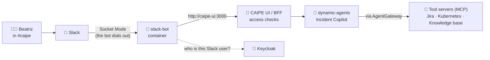

# 💬 CAIPE in Slack: talk to your agents from a channel

*The agents do not change. The front door does: the same Incident Copilot, the same teams and the same approvals, reached from a Slack channel instead of the web UI.*

CAIPE ships a Slack bot. This guide wires it to the **Incident Copilot** demo, so an on-call engineer can ask about a ticket from `#caipe` and get the answer in a thread. It also records every trap hit while doing it on a docker compose install, with the fix for each.

> 📸 **Screenshots.** Every `📸` box below is a placeholder. Save your image under [`slack/images/`](images/) with the suggested name,
> then uncomment the matching `![...]` line right under the box.

**On this page**
1. [The idea in one page](#1--the-idea-in-one-page)
2. [What you need first](#2--what-you-need-first)
3. [Setup, step by step](#3--setup-step-by-step)
4. [Run it and check it](#4--run-it-and-check-it)
5. [The scenario: Beatriz works a ticket from Slack](#5--the-scenario-beatriz-works-a-ticket-from-slack)
6. [When something goes wrong](#6--when-something-goes-wrong)
7. [Good to know](#7--good-to-know)

---

## 1. 🧭 The idea in one page



| | Piece | What it does |
| --- | --- | --- |
| 🤖 | **`slack-bot`** | A Slack app running as one more container. In **Socket Mode** it opens an outbound connection to Slack, so you need **no public URL** for it. Your Cloudflare tunnel is untouched. |
| 🗺️ | **Channel route** | Each Slack channel is mapped to one agent and one team. A mention in `#caipe` goes to the Incident Copilot. |
| 🧑 | **Identity** | The bot finds the Keycloak user behind the Slack user and calls CAIPE **as that person** (on-behalf-of). Teams, agent grants and tool grants apply exactly as in the web UI. |
| ✋ | **Approvals** | A tool marked "ask first" pauses the run. In Slack this arrives as a form with Approve and Deny buttons. |

> 👥 **Two doors, one rulebook.** Slack does not bypass anything. If a person cannot use an agent or a knowledge base in the web UI, they cannot in Slack either.

---

## 2. 🧰 What you need first

This guide starts **after** the demo from the [setup guide](../docs/README.md) works in the web UI. It also assumes:

| ✔ | Already in place | Where it comes from |
| --- | --- | --- |
| ☐ | CAIPE running with docker compose, with the `rbac`, `dynamic-agents` and `rag` profiles | your CAIPE install |
| ☐ | The four agents, the `support` / `oncall` / `owner` teams and the Jira tool server | [Setup guide](../docs/README.md) |
| ☐ | Admin access to a Slack workspace where you may create apps | your Slack workspace |
| ☐ | Keycloak's admin console reachable, for example `http://localhost:7080/admin` through an SSH or VS Code port forward | your CAIPE install |
| ☐ | The Slack user's **email** matches a Keycloak user's email | see [3.5](#35--link-the-slack-user-to-a-keycloak-user) |

> 🔑 **Handle secrets with care.** The Slack tokens, the Keycloak client secret and the admin password all end up in `.env`. Check that it is ignored by git and has mode `600`. Never paste them into chats, tickets or screenshots.

---

## 3. 🧱 Setup, step by step

Menu names can differ a little between Slack and CAIPE versions.

### 3.1 🟣 Create the Slack app

At [api.slack.com/apps](https://api.slack.com/apps): **Create New App → From a manifest**, then pick your workspace. Or build it by hand with the settings below.

| Where in the Slack app | Set this |
| --- | --- |
| **Settings → Socket Mode** | **Enable Socket Mode**. Slack offers to generate the app-level token (next row). |
| **Settings → Basic Information → App-Level Tokens** | Generate one with the `connections:write` scope. This is the `xapp-…` token. |
| **Features → OAuth & Permissions → Bot Token Scopes** | `app_mentions:read` · `channels:history` · `channels:read` · `chat:write` · `commands` · `groups:history` · `groups:read` · `im:history` · `im:read` · `im:write` · `mpim:history` · `reactions:write` · `users:read` · `users:read.email` |
| **Features → Event Subscriptions** | Turn on **Enable Events**. Subscribe to the bot events `app_mention`, `message.channels`, `message.groups`, `message.im`. No Request URL is needed in Socket Mode. |
| **Features → Interactivity & Shortcuts** | Turn **Interactivity** on (needed for the Approve and Deny buttons). |
| **Features → App Home** | Turn on the **Messages Tab**, and tick **Allow users to send Slash commands and messages from the messages tab**. Without it, direct messages are blocked. |
| **Features → Slash Commands** *(optional)* | `/caipe-help`, `/caipe-list`, `/caipe-use`, `/caipe-effort`. Create them **after** enabling Socket Mode, and the Request URL field disappears. |
| **Settings → Install App** | **Install to Workspace**. Copy the **Bot User OAuth Token** (`xoxb-…`) from **OAuth & Permissions**. |

> 💡 **The `commands` scope appears on its own.** You do not add it by hand. Slack adds it after you create the first slash command. If it still does not show in the list, add it in **Settings → App Manifest** under `oauth_config → scopes → bot`, save, and reinstall.

> ⚠️ **`users:read.email` is not optional.** Without it the bot cannot see anyone's email, so it cannot match the Slack user to a Keycloak user, and every request runs as "minimum access (unlinked)". Add a scope later and you must **Reinstall to Workspace**.

In Slack itself, invite the bot to the channel (`/invite @CAIPE`), and copy the channel ID: open the channel, click its name, scroll to the bottom of the **About** tab. It starts with `C`.

> 📸 **Screenshot:** *Socket Mode enabled and the app-level token generated (blur the token)*
> `slack/images/01-slack-socket-mode.png`
> <!--  -->

> 📸 **Screenshot:** *Bot token scopes list*
> `slack/images/02-slack-scopes.png`
> <!--  -->

> 📸 **Screenshot:** *Event subscriptions with the four bot events*
> `slack/images/03-slack-events.png`
> <!--  -->

---

### 3.2 🔑 Give the bot its own Keycloak identity

The bot logs in to CAIPE with the Keycloak client **`caipe-slack-bot`**. You need its secret.

1. Open the Keycloak admin console (`http://localhost:7080/admin`). Log in as `admin`.
2. Choose the **`caipe`** realm in the dropdown at the top left.
3. **Clients → `caipe-slack-bot` → Credentials** tab → copy the **Client Secret**.
   If the Credentials tab is missing, turn on **Client authentication** under **Settings** and save.

> 🔒 If you rotated the stack's default secrets, this client's secret was regenerated and is not written down anywhere. Read it from the console, or press **Regenerate**.

> 📸 **Screenshot:** *`caipe-slack-bot` client, Credentials tab (blur the secret)*
> `slack/images/04-keycloak-slack-client.png`
> <!--  -->

---

### 3.3 📝 Configure `.env`

In your CAIPE install's `.env`. Placeholders are in `<angle brackets>`.

```bash
# --- Slack tokens -------------------------------------------------------
# The bot reads the SLACK_INTEGRATION_* names. The UI's "Find channels" button
# reads the plain SLACK_BOT_TOKEN, so set both to the same values.
SLACK_INTEGRATION_BOT_TOKEN=<xoxb-...>
SLACK_INTEGRATION_APP_TOKEN=<xapp-...>
SLACK_BOT_TOKEN=<xoxb-...>
SLACK_APP_TOKEN=<xapp-...>
SLACK_INTEGRATION_BOT_MODE=socket

# --- How the bot logs in to CAIPE --------------------------------------
SLACK_INTEGRATION_ENABLE_AUTH=true
SLACK_INTEGRATION_AUTH_TOKEN_URL=http://keycloak:7080/realms/caipe/protocol/openid-connect/token
SLACK_INTEGRATION_AUTH_CLIENT_ID=caipe-slack-bot
SLACK_INTEGRATION_AUTH_CLIENT_SECRET=<client secret from 3.2>

# --- Act as the person who asked (per-user identity) --------------------
SLACK_RBAC_ENABLED=true
SLACK_WORKSPACE_ALIAS=CAIPE
KEYCLOAK_BOT_CLIENT_ID=caipe-slack-bot
KEYCLOAK_BOT_CLIENT_SECRET=<same client secret>

# --- Links, routes and the admin status check ---------------------------
CAIPE_UI_BASE_URL=https://<your-caipe-hostname>
SLACK_AGENT_ROUTES_MODE=db_prefer
SLACK_INTEGRATION_DEFAULT_AGENT_ID=<agent id for unmapped channels>
SLACK_INTEGRATION_DM_AGENT_ID=<agent id for direct messages>
SLACK_BOT_ADMIN_URL=http://slack-bot:3001
SLACK_ADMIN_JWT_ISSUER=https://<your-keycloak-hostname>/realms/caipe
```

Then add the profile to the existing line:

```bash
COMPOSE_PROFILES=<existing profiles>,slack-bot
```

| 🧩 Setting | Why it matters |
| --- | --- |
| `SLACK_INTEGRATION_ENABLE_AUTH=true` | With auth off, the bot calls the UI with no token, which an RBAC-protected UI refuses. |
| `SLACK_RBAC_ENABLED=true` + `KEYCLOAK_BOT_*` | Without it, every Slack user acts as the bot's own service account, and your team rules do not apply. With it, each request runs as the real person. |
| `SLACK_BOT_ADMIN_URL` | The UI defaults to the Kubernetes service name. In compose it must be `slack-bot:3001`, or the Slack page reports **"Degraded: Slack bot admin check timed out"**. |
| `SLACK_ADMIN_JWT_ISSUER` | Needed only if Keycloak is published under a public hostname. Tokens carry the public issuer, so the bot must expect it. |
| `SLACK_INTEGRATION_BOT_CONFIG` | Optional. A static YAML map of channel to agent. The channel routes in 3.6 are the main mechanism. |

> 🧩 **Agent IDs.** The UI may prefix agent IDs, for example `agent-incident-copilot` for the agent seeded as `incident-copilot`. Copy the exact ID the bot logs on the first request.

---

### 3.4 🚀 Start it

```bash
export COMPOSE_PROFILES="$(grep '^COMPOSE_PROFILES=' .env | cut -d= -f2)"
docker compose up -d slack-bot caipe-ui
docker logs -f slack-bot
```

✅ **Check:** you see `Enterprise RBAC enforcement enabled`, `Connected to CAIPE API (status 200)` and `Starting CAIPE Slack Bot in Socket Mode`.

---

### 3.5 🔗 Link the Slack user to a Keycloak user

The bot matches the **email on the Slack profile** to a Keycloak user.

| What happens | Result |
| --- | --- |
| Emails match | The bot links that Keycloak user (it stores the Slack user ID in the `slack_user_id` attribute) and calls CAIPE as them. ✅ |
| No Keycloak user matches | With `SLACK_JIT_CREATE_USER=true` (the default) the bot **creates a new user** with no roles and no teams. It works, but that person has no access to anything. ⚠️ |

So before the first message, make sure that **the email on your Slack profile is the email of the Keycloak user who has the teams you want**. Otherwise fix it afterwards:

1. In Keycloak, give the new user the roles it needs, and add it to its teams in the CAIPE web UI (**Admin → Teams**).
2. **Sign in to the CAIPE web UI once as that user.** See the note below.

> ⚠️ **One web UI sign-in is still required.** The gateway lets a user call tools only if OpenFGA holds `user:<id> caller mcp_gateway:list`, which is written on the first interactive web UI login (or by a directory sync). A user created from Slack alone does not have it, so every tool server answers **403** and the agent starts with **zero tools**. This is an open limitation, see [Good to know](#7--good-to-know).
>
> The JIT user has no password. In Keycloak, open **Users → the user → Credentials** and set one (mark it temporary), then sign in at your CAIPE URL.

---

### 3.6 🗺️ Map the channel to an agent and a team

In the CAIPE web UI, signed in as an admin: **Admin → Integrations → Slack → Onboard channels**.

1. Click **Find channels** (needs `SLACK_BOT_TOKEN` from 3.3). If it fails, paste the channel ID.
2. Select `#caipe`, then pick the **agent** (Incident Copilot) and the **team** (`oncall`).
3. Apply.

The alternative is **Advanced → Import from Slackbot YAML**: preview, then apply. A channel imported this way still needs a team assigned.

Keep the access table of the [main README](../README.md#-who-can-reach-what) in mind. Map the channel to the team that is meant to reach that agent.

> 📸 **Screenshot:** *Onboard channels: `#caipe` mapped to the Incident Copilot and the `oncall` team*
> `slack/images/05-onboard-channel.png`
> <!--  -->

> 📸 **Screenshot:** *The Slack integration page showing the bot as healthy*
> `slack/images/06-slack-admin-healthy.png`
> <!--  -->

---

### 3.7 📚 Let the team search the knowledge bases

The agents use the knowledge base through the same permissions as in the web UI. For a non-admin team:

- Assign the datasources to the team (**Admin → Teams → the team**), as in the [setup guide](../docs/README.md).
- Turn on the team's **search capability**. The RAG server asks for it in addition to the per-datasource grant, so a team with a datasource but without it gets **zero results**. In OpenFGA it is the tuple `team:<slug>#member searcher organization:caipe`.

Your cisco-style admin user passes this check through its admin role, which is why it works for you in the web UI while a regular team member is refused.

---

## 4. ▶️ Run it and check it

1. In `#caipe`, send `@CAIPE hello, which tickets are open?`.
2. A plain message with no mention is ignored, since the route listens for **mentions** only.
3. Read the bot log:

```bash
docker logs --since 5m slack-bot | grep -E "invoked|mapped to team|OBO|dispatch_identity|Error"
```

| 🔎 In the log | What it tells you |
| --- | --- |
| `CAIPE was invoked by User: …, Email: <address>` | The bot sees the email. `Email: None` means `users:read.email` is missing. |
| `Channel=… mapped to team=oncall` | The channel route and team were found. |
| `OBO impersonation succeeded for user=<id>` | The bot is calling CAIPE as that person. |
| `dispatch_identity: run_as=obo_user agent=…` | The right agent was chosen. |

And in `dynamic-agents`:

```bash
docker logs --since 5m dynamic-agents | grep -E "loaded|MCP server|denied"
```

✅ **Healthy:** `loaded N tools from M/M MCP servers`. ❌ `HTTP 403 … [denied]` means the user cannot call tools, see [section 6](#6--when-something-goes-wrong).

> 📸 **Screenshot:** *`#caipe` with the first question and the agent's reply in a thread*
> `slack/images/07-first-answer.png`
> <!--  -->

---

## 5. 🎭 The scenario: Beatriz works a ticket from Slack

The same story as the [walkthrough](../docs/README.md#5--the-walkthrough-who-does-what-in-order), with Slack as the front door. Beatriz is on call, and `#caipe` is mapped to the **Incident Copilot** and the **`oncall`** team.

| Step | In Slack | What happens behind it |
| --- | --- | --- |
| 1 | `@CAIPE List the open LedgerLite tickets.` | The bot resolves Beatriz to her Keycloak user, calls the Incident Copilot as her, and the agent reads Jira through the gateway. A table of tickets comes back in the thread. |
| 2 | `@CAIPE Work on AIPLATFORM-n.` | The Copilot asks the Cluster Agent and the Knowledge Agent, writes the diagnosis, and wants to move the ticket. |
| 3 | An approval form appears with **Approve** and **Deny** | The run pauses at the "ask first" tool. |
| 4 | Follow-up questions in the same thread | The thread keeps its context. A new top-level mention starts a new conversation. |

> 📸 **Screenshot:** *The ticket list in the thread*
> `slack/images/08-ticket-list.png`
> <!--  -->

> 📸 **Screenshot:** *The approval form in Slack*
> `slack/images/09-approval-form.png`
> <!--  -->

**The point:** the person asking in Slack gets what their team allows. A support user asking the same question is routed to the Support Agent and never sees the runbooks.

---

## 6. 🩺 When something goes wrong

Each row is something that happened while building this. Read the log lines in the first column.

| 👀 What you see | Why | Fix |
| --- | --- | --- |
| *"You're using minimum access (unlinked)"*, log shows `Email: None` | The bot token has no `users:read.email` scope, or the app was not reinstalled | Add the scope, **Reinstall to Workspace**, then restart `slack-bot` |
| *"Agent … is not assigned to this channel"*, log `missing_channel_grant` | The channel has no agent grant in OpenFGA. The static YAML is not enough in RBAC mode | Map the channel in **Admin → Integrations → Slack** (3.6) |
| *"You don't have access to agent …"*, log `agent#use`, `pdp_denied` | The caller has no right to use the agent: the bot acted as its service account, or the user is not in a team that has the agent | Turn on `SLACK_RBAC_ENABLED=true` (3.3), and add the user to a team with the agent |
| The agent says *"I can't reach Jira"*, or answers with **tickets that do not exist**; gateway returns **403**; log shows `DENY_NO_CAPABILITY` | The user lacks `caller mcp_gateway:list`, so all tool servers are refused and the agent has no tools. With no tools, a model can invent plausible answers | Sign in to the web UI once as that user (3.5) |
| Log shows a different email than the one you expect, and a **new** Keycloak user appeared | The Slack profile email matched no Keycloak user, so the JIT feature created one | Use the right email in Slack, or give the new user roles and teams |
| *"Degraded: Slack bot admin check timed out"* in the UI | The UI looks for the bot at the Kubernetes service name | `SLACK_BOT_ADMIN_URL=http://slack-bot:3001`, and set `SLACK_ADMIN_JWT_ISSUER` for a public Keycloak |
| *"SLACK_BOT_TOKEN is not configured on the UI service"* when finding channels | The UI reads the plain `SLACK_BOT_TOKEN`, not the `SLACK_INTEGRATION_*` name | Set both (3.3) and recreate `caipe-ui` |
| Knowledge agent finds nothing, `0 semantic, 0 keyword results`, even for an admin | The vector collection is empty | Re-ingest the documents, and set `CLEANUP_ENABLED=false` for `rag-server` |
| A regular team member gets zero search results, an admin does not | The team is missing the **search capability** | Turn it on for the team (3.7) |

> 🔎 **A quick way to find the cause of a "no tools" problem:** compare `docker logs agentgateway` (look for `403` and the `jwt.sub`) with `docker logs openfga-authz-bridge` (look for `DENY_NO_CAPABILITY`). The bridge tells you which grant is missing.

---

## 7. ⚠️ Good to know

| | Note |
| --- | --- |
| 🧪 | **Everything here was done on the `0.5.66` images.** The repo source I read is `1.3.0-rc.16`, whose images are not published. A few names in the source may differ from what the images do. |
| 🧑 | **A Slack-only user cannot use tools until one web UI sign-in.** The gateway permission is only written on the first interactive login or a directory sync. The expectation that Slack users never need the web UI is not met today. |
| 🤥 | **An agent with no tools may invent answers.** Add a line like *"If a tool is unavailable, say so. Never invent tickets or data."* to the agent's instructions. |
| 🧱 | **Uploaded knowledge-base files expire.** Their chunks get a freshness time of about 36 hours, and the daily cleanup removes them. Nothing re-ingests an uploaded file. Disable the cleanup (`CLEANUP_ENABLED=false`) or re-upload. With cleanup off, stale data from real ingestors is never removed. |
| 🔁 | **Mentions only.** The route in this guide replies when mentioned (`listen: mention`). Listening to every message in a channel is possible but noisy. |
| 🔐 | **Many secrets, one file.** The bot container reads the whole `.env` through `env_file`. Keep it at mode `600`, and rotate any token that has been pasted into a chat or log. |
| 🌐 | **No public URL for Slack.** Socket Mode needs only outbound access. If you ever switch to HTTP mode, you would have to publish the bot's port. |

> Everything in this demo is synthetic: fictional customers, fictional payments, a made-up app. 🧪
